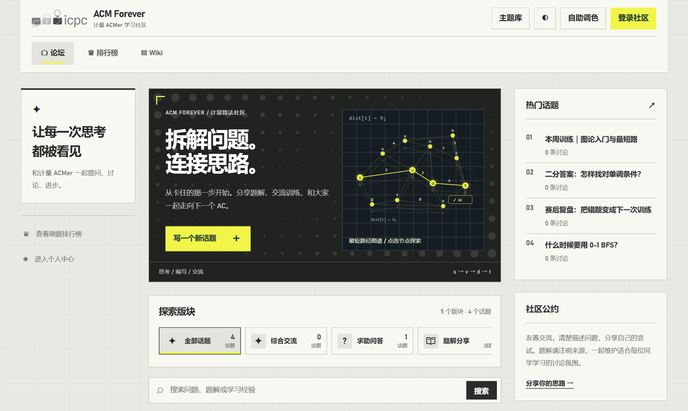

<h1 align="center">ACM-Forever</h1>

**面向 CJLU ACM 队伍的算法训练与交流平台。**

在这里找题、跟进队内训练、和队友交流题解。**代码在原在线评测平台（OJ）提交，本站同步刷题记录。**

[成员入门](#成员入门) · [本地运行](#本地运行) · [下载 Android 客户端](https://github.com/GiraffesLoveBeauty/ACM-Forever/releases/latest) · [开发与运维](#开发与运维)



*Web 论坛首页，使用本地演示数据。*

## 能做什么

| 功能 | 使用场景 |
| --- | --- |
| **题库与过题记录** | 浏览 Codeforces、AtCoder、洛谷等平台的已收录题目，按标签或难度找题，查看已同步的通过记录。 |
| **训练与复盘** | 按难度安排今日训练，查看队内题单、截止时间与逐题完成情况，赛后记录补题进度。 |
| **论坛与 Wiki** | 发帖分享题解、提问或交流训练心得；在 Wiki 按知识点阅读讲义、查找关联练习。 |
| **成员管理与统计** | 成员可查看排行榜；管理员可管理账号、发布训练任务、审核社区内容。 |

## 成员入门

1. 向队内管理员获取站点地址与账号。登录后，在 **个人中心 → OJ 绑定与同步** 检查绑定并同步记录。
2. 在 **个人中心 → 训练与题目** 打开题库、今日训练或训练任务，选题后前往原 OJ 提交。
3. 回站同步记录或刷新训练任务进度。赛后可在 **赛事复盘** 标记待补题目。

第一次接到队内题单？参阅 [训练任务使用指南](docs/training-tasks/member.md)。

## 本地运行

以 **Windows PowerShell** 为例。需要 Git、Python 3.12、Node.js ≥ 22.13 和 pnpm 11.25.0。

```powershell
git clone https://github.com/GiraffesLoveBeauty/ACM-Forever.git
cd ACM-Forever

py -3.12 -m venv .venv
$python = (Resolve-Path .\.venv\Scripts\python.exe).Path
& $python -m pip install -r feat/api/requirements.txt
pnpm --dir feat/web install --frozen-lockfile
pnpm --dir feat/web build

$env:ACM_API_HOST = '127.0.0.1'
$env:ACM_API_PORT = '8088'
$env:ACM_DATABASE_PATH = 'feat/data/local-dev.sqlite3'
$env:ACM_WEBUI_SECRET_KEY = & $python -c "import secrets; print(secrets.token_urlsafe(48))"
& $python -m feat.api
```

浏览器打开 <http://127.0.0.1:8088>。首次运行会建立本地 SQLite 库，不包含正式站的账号和题目。要测试登录，可按 [API 服务说明](feat/api/README.md#数据库与部署) 初始化本地账号。按 `Ctrl+C` 停止服务。

- **修改前端**：保持 API 运行，另开终端执行 `pnpm --dir feat/web dev`，访问 <http://127.0.0.1:5173>。参见 [前端开发指南](feat/web/README.md)。
- **验收标签与翻译**：运行 [隔离演示](local_demo/README.md)，按文档生成合成题目，无需连接正式环境。

## 开发与运维

| 目录 | 职责 | 入口 |
| --- | --- | --- |
| [`feat/web/`](feat/web/) | Vue 3 + Vite Web 前端 | [前端开发](feat/web/README.md) |
| [`feat/api/`](feat/api/) | Python / Quart API、SQLite 数据访问与 Web 静态资源服务 | [API 文档](docs/api.md) |
| [`Android_APP/`](Android_APP/) | 原生 Android 客户端 | [构建与发布](docs/android-app.md) · [android-v1.0.2-compact-ranking.md（排名小屏布局）](docs/android-v1.0.2-compact-ranking.md) |
| [`tools/crawlers/`](tools/crawlers/) | 题目元数据、题面与样例采集 | [采集说明](docs/crawler-samples.md) |
| [`local_demo/`](local_demo/) · [`experiments/`](experiments/) | 算法标签与翻译实验、本地验收 | [交付说明](docs/algorithm-tagging-delivery.md) |

`feat/` 的变更合并到 `main` 后，[部署工作流](.github/workflows/sync-feat-to-server.yml) 会构建前端并同步应用。数据库、上传文件与环境配置应独立于代码部署目录。操作前请阅读 [部署与迁移](docs/public-server-deployment.md) 和 [备份与恢复](docs/backup-and-diagnostics.md)。

更多文档：[训练任务管理](docs/training-tasks/admin.md) · [Wiki 维护](docs/wiki.md) · [浏览器回归测试](docs/browser-regression.md) · [android-gitee-mirror-recovery.md（Gitee 发布诊断与恢复）](docs/android-gitee-mirror-recovery.md) · [全部工程文档与历史记录](docs/)。

## 参与贡献

欢迎通过 [Issues](https://github.com/GiraffesLoveBeauty/ACM-Forever/issues) 报告问题或讨论需求。开发请使用主题分支，通过 Pull Request 合并到 `main`，并在 PR 中说明变更范围、验证步骤和结果。不要提交业务数据库、环境密钥或签名文件。
