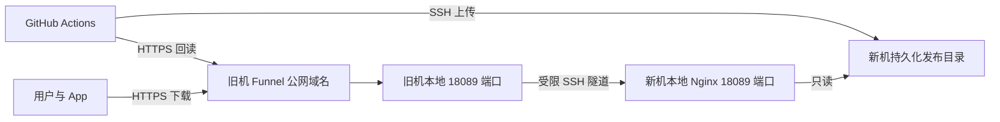

# 新机上传、旧机 Funnel 下载的运维说明

2026-11-06。此方案只调整 Android 制品的下载入口，网站和数据库继续使用现有部署。

## 路径与配置



- 上传目标继续是新机 `118.178.192.81:22` 的专用 `acmrelease` 账号，目录 `/srv/acmforever-releases`。原 Actions 镜像 Variables、Secrets 保留。
- 下载源为 `https://cjluacmpanel.tail1b9e55.ts.net`。工作流 `DOWNLOAD_ORIGIN`、App 默认更新清单和清单生成的主 APK URL 必须使用同一源。
- 公开路径限于 `/GiraffesLoveBeauty/ACM-Forever/releases/`；GitHub 清单与同 Tag APK 仍为备用源。
- 首次正式镜像发布前，`latest/update.json` 返回404是预期行为。临时探测文件不作为正式清单或安装包发布。
- 旧机原有 `/` 到 `http://127.0.0.1:8088` 的代理保留。本方案不更新该业务服务，不迁移数据库或图片。

## 新机静态源和 SSH 权限

[Nginx loopback 模板](../Android_APP/deploy/nginx-release-relay.conf.example) 是完整 `server` 块，放入现有 Nginx 的 `http` 配置。仅监听 `127.0.0.1:18089`；除发布路径外均返回404。保留APK/JSON/checksum MIME、no-store、nosniff、禁止隐藏文件、目录列表、符号链接和写方法。

当前配置位于 `/www/server/panel/vhost/nginx/acm-release-relay-loopback.conf`。通过 `nginx -t` 后平滑 reload。新机使用宝塔管理的 Nginx，不要因 systemd nginx 显示 inactive 就另启第二个实例。

两台机器分别使用独立的 `acmrelay` 系统账号，无 sudo。私钥仅在旧机生成并保留，权限0600；不上传 GitHub，不复用网站部署或镜像上传私钥。新机通过 root 所有的 `/etc/ssh/authorized_keys/acmrelay` 接受这把公钥：

```text
restrict,port-forwarding,permitopen="127.0.0.1:18089" ssh-ed25519 PUBLIC_KEY
```

新机在 `sshd_config` 末尾为该账号单独添加如下策略；先备份，再用 `sshd -t` 校验并 reload SSH：

```text
Match User acmrelay
    AuthorizedKeysFile /etc/ssh/authorized_keys/acmrelay
    AuthenticationMethods publickey
    PasswordAuthentication no
    KbdInteractiveAuthentication no
    AllowTcpForwarding local
    PermitOpen 127.0.0.1:18089
    PermitListen none
    AllowAgentForwarding no
    X11Forwarding no
    PermitTTY no
    MaxSessions 0
```

该策略允许本地端口转发到唯一静态端口，禁止远程监听和命令会话；不改变其他 SSH 用户的策略。

## 旧机服务与 Funnel 路径

[systemd 模板](../Android_APP/deploy/acm-release-relay.service.example) 安装为 `acm-release-relay.service`。旧机 `/etc/acm-release-relay/known_hosts` 固定新机 host key，经已有可信 SSH 管理通道核对，避免运行时盲目信任扫描结果。

隧道只监听旧机 `127.0.0.1:18089`，转发到新机 `127.0.0.1:18089`。systemd 设置开机启动、断线5秒后重连，SSH 每15秒保活、连续3次无响应退出。

添加下载路径，不重置整个 Funnel：

```bash
sudo tailscale funnel --bg --yes --https=443 \
  --set-path=/GiraffesLoveBeauty/ACM-Forever/releases/ \
  http://127.0.0.1:18089/GiraffesLoveBeauty/ACM-Forever/releases/
```

Tailscale 路径代理会剥离挂载前缀，因此上游 URL 必须带同一个发布前缀。配置后检查 `tailscale serve status --json`，确认原根路径代理和 `AllowFunnel` 保留。

查看运行状态与日志：

```bash
sudo systemctl status acm-release-relay.service
sudo journalctl -u acm-release-relay.service -f
tailscale funnel status
```

新机静态访问和错误日志：`/www/wwwlogs/acm-release-relay.access.log`、`/www/wwwlogs/acm-release-relay.error.log`。

## 带宽与可用性边界

下载吞吐取新机出口、SSH隧道、旧机出口、Funnel路径和客户端入口中的最小值。单次下载会消耗新机与旧机各一份文件的出口流量；此方案没有在旧机缓存文件，也没有多节点容灾。

4 MiB随机文件的初步测试：

| 测试路径 | 实测结果 |
| --- | --- |
| 新机本地 Nginx | 约0.02秒 |
| 新机经SSH到旧机 | 约5.15秒，文件传输约6.56 Mbps |
| 本机固定连接Funnel公网IP | 约81.96秒，文件传输约0.42 Mbps |
| GitHub-hosted runner 公网HTTPS完整回读 | 约14.77秒，含握手有效吞吐约2.27 Mbps |

测试使用不可压缩随机内容并核对SHA-256；本机公开入口测试显式连接公网IP，保留域名SNI与证书校验，没有走Tailscale内网。新机作为公网下载客户端的一轮测试出现读超时，说明不同网络访问表现仍需验证。上述数值是一次采样，不等于购买带宽或稳定限速。

按0.42 Mbps粗估，当前约2.94 MB的APK传输约56秒，另加握手等开销。若多人均分相同总吞吐，耗时近似随并发人数增加；不能将其作为所有用户的速度保证。现有证据只能把较慢部分缩小到旧机到Funnel网关及网关到客户端的公网路径，不能进一步断言是Funnel固定限速。

## 验收与回滚

必须由未加入tailnet的GitHub-hosted runner验证：专用账号SSH上传、实际 `SSHMirror.public_check` 完整HTTPS回读及哈希、GET/HEAD与MIME/cache头、缺失404、隐藏/目录/写入拒绝，以及探测文件清理后404。手机安装与覆盖更新仍需正式发版后单独验证。回读失败继续报错，不跳过校验。

2026-11-06 [GitHub公网验收运行](https://github.com/GiraffesLoveBeauty/ACM-Forever/actions/runs/42063206214) 为success。使用PR105的镜像模块验证上述项目，包含4 MiB随机内容的完整回读；探测文件已删除，没有创建正式APK、Tag或latest清单。本地51项发布故障注入测试通过；默认清单与工作流下载源一致性检查通过。临时测速分支在验收后删除。

隧道自动重连已实测：向SSH主进程发送TERM后，systemd的重启计数从0变为1，约6秒恢复静态源访问；原有Funnel根路径和公开设置保持不变。

若需要撤回下载入口，先停止新的发布，再仅删除新增路径：

```bash
sudo tailscale funnel --bg --yes --https=443 \
  --set-path=/GiraffesLoveBeauty/ACM-Forever/releases/ off
sudo systemctl disable --now acm-release-relay.service
```

不要执行不带路径的 Funnel `off` 或 `reset`，以免关闭原网站入口。若修改发布源，App内置清单、工作流和APK URL必须同步。恢复新机原SSH策略前先核对备份与其他人的后续改动；验证 `sshd -t` 后仅reload。
