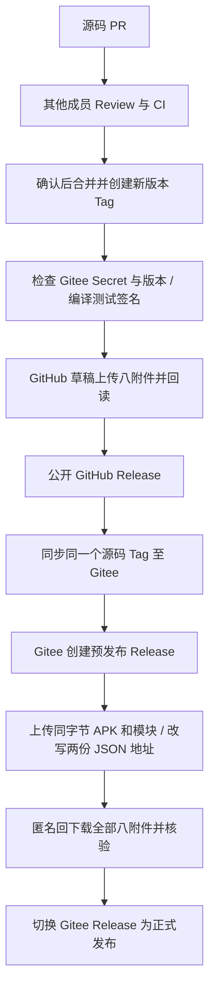

# Android v0.2.27：Gitee 优先更新与完整镜像发布

日期：2026-11-15。当前为 **0.2.27 / versionCode 41 / debug** 源码评审候选，基于 main `6b7536fbb91c0cd30770a14302554e425e5f2ce9`；上一公开版本为 v0.2.26/code40。本轮提交 PR 供其他成员 review，不合并、创建 Tag 或发布制品。1.0.0 和自站更新仍独立等待。

## 可行性实测

用户指定的 [Gitee 仓库](https://gitee.com/MJJ13445/ACM-Forever) 是公开仓库，默认分支 main。匿名访问仓库 API 和原始 README 成功，已导入 v0.2.14～v0.2.26 Tag；但 Release 列表为空，根目录没有 update.json。导入 GitHub 源码与 Tag 不会导入 Release 附件。

另以公开项目 dromara/Jpom 的40字节 `.sha1` 附件实测：浏览器下载 URL 与官方附件下载 API 均可匿名 HTTPS 下载，重定向到 `foruda.gitee.com`，内容一致。这证明服务能力可用，**不代表本项目尚未发布的 APK 已经在 Gitee 可用**。本项目首次发布必须完成下方凭据配置和全部附件回读。

参考接口定义为 Gitee 官方 [OpenAPI Swagger](https://gitee.com/api/v5/swagger_doc)：Release latest、按 Tag 查询、创建及修改 Release、`attach_files` 上传与列表。未使用网页登录 Cookie 或模拟上传私有接口。

## 客户端行为

1. 默认入口为 `https://gitee.com/api/v5/repos/MJJ13445/ACM-Forever/releases/latest`，读取正式 Release 的 Tag，再读取该 Tag 下的 `update.json`。
2. 清单校验包名、版本、渠道、大小、SHA-256；Gitee 入口额外要求 Tag、APK URL 与 modulesUrl 都属于同仓库同版本。预发布、404、超时、HTML 登录页、错误 JSON 或不合法清单均尝试 GitHub 原更新清单。
3. Gitee 已有更新且比本机新时优先使用它。Gitee 版本不高于本机时，另尝试 GitHub，防止镜像延迟隐藏已发布更新；GitHub 失败仍保留有效的 Gitee 结果，同版本优先 Gitee。
4. Gitee APK 由系统 DownloadManager 下载。系统报告传输失败时最多切换一次同版本同渠道 GitHub URL；空间不足、设备存储不可用及文件已存在不切源。手动取消不重试；APK 哈希/包名/版本/签名失败不会绕过验证。系统自行暂停和重试期间不同时开启另一份下载。
5. 模块清单按同版本 Gitee → GitHub → 本机有效缓存；Gitee 模块下载失败后尝试同版本同模块 GitHub 文件。每次仍校验大小、哈希，安装前校验实际签名与版本。已下载模块与设置保留，不下载用户未选择的模块。
6. 更新页显示首选地址、兜底说明和最近成功来源。用户手工设置的清单地址只访问该地址，不擅自重置；保存空地址恢复 Gitee 优先默认值。旧版自动检测开关、先会话后检查、更新弹窗、手动下载及系统确认安装的流程保持。

旧版用户尚无此默认源，需要先通过 GitHub 或从 Gitee Release 手动下载一次新版；安装后使用新默认值。相同包名和固定证书覆盖安装保留数据。自行设置过地址的用户须清空自定义地址才使用默认优先级。

## Tag 自动发布与配置

仍由 GitHub Actions 编译一次基础包与原生模块，沿用固定 debug 签名；Gitee 不重新编译，不上传 APK 到源码 Git。

管理员在 GitHub 仓库 **Settings → Secrets and variables → Actions → New repository secret** 配置 `GITEE_RELEASE_TOKEN`，使用对 `MJJ13445/ACM-Forever` 有仓库写入与 Release 附件操作权限的 Gitee 访问令牌。只在 Secret 保存，不写入源码、App、聊天、URL 或日志。本次只读检查确认该 Secret 尚未配置；本 PR 不创建或索取令牌。

工作流在编译及公开 GitHub Release **之前**检查 Secret 非空。Gitee 写凭据仅供发布 Action 使用；App 全程匿名下载。同步只推送本次 Tag 及其源码对象，不改 Gitee main、GitHub main、网站部署和业务数据库。已有同名 Gitee Tag 指向别处时拒绝移动。

八附件：基础 APK、对应 `.sha256`、`update.json`、`modules.json`、`module-advanced.apk`、`module-admin.apk`、`module-official-themes.acmpack`、`module-cat-art.acmpack`。Gitee 两份 JSON 的 URL 改为 Gitee 同版本地址，APK与四模块字节、体积、哈希及签名不变；不要求两站 JSON 字节相同。

Gitee 没有本流程使用的 draft 字段，以 `prerelease=true` 暂存；最新版本检查拒绝预发布。所有附件匿名回读正确后才切 `prerelease=false`。已公开附件不可替换，完全一致的重跑只校验；中途失败的预发布可在同 Tag 重跑时补齐缺失文件，已有文件不同则阻止。不能删除 Tag、覆盖 APK 或略过回读来解决失败。

GitHub 先发布、Gitee 后同步，跨站不是原子事务。若后半段失败，GitHub 可能已公开、Gitee 仍预发布；App 可兜底 GitHub，修复配置/网络后重跑原 Tag 工作流。Gitee 旧正式版低于本机时，客户端会检查 GitHub 较新版本。国内网络、Gitee 配额、令牌权限及下载策略仍需首次真实镜像验收。

## 验证与 Review

本轮本地验证结果：

- Android JVM 测试 **214 项通过，0 失败**；发布、署名与 Gitee 镜像契约测试 **57 项通过，0 失败**；官方主题资源测试 **2 项通过**。
- Lint **0 errors / 68 warnings**；基础 debug APK、advanced/admin 原生模块和 instrumentation APK 均构建成功。
- 模拟器 `giteeupdates` 通过：默认 Gitee、新版本优先且不请求 GitHub 清单、源故障兜底、实际更新页来源文案、Gitee CDN 重定向、模块同版本切源、取消与临时文件清理、自定义源保持。
- 模拟器 `startupupdates` 通过：默认勾选及关闭记忆、会话恢复后检查、进程内去重、弹窗版本与说明、同尺寸按钮及取消色、重建、下载/重试/取消、最新版本确认、失败重试及六小时节流。

新增测试涵盖源顺序、异常/非法清单兜底、自定义源、镜像延迟、同版本 APK URL、模块 URL 白名单、发布完整性、失败恢复和不可变附件。模拟器使用合成 HTTPS 传输，不访问生产账号或向 Gitee 写入测试附件。真实网络只进行了前述匿名读取；凭据未配置，**尚未验收本项目 Gitee 的真实 Tag 推送、Release 写入、附件大小配额及完整 APK 下载**。上述发布测试使用内存夹具，不能代替首次真实发布验收。本机日志保存在被忽略的 `Android_APP/dist/gitee-v0.2.27-local/` 及同级构建日志，不提交源码库。

Review 重点：跨源仍只安装相同身份的制品；取消与重建不启动无限重试；Gitee Tag 不覆盖；令牌不进客户端与日志；八附件全通过才公开；GitHub 既有发布校验仍有效。PR 合并及首次 Tag 发布前，管理员需配置 Secret 并确认 Gitee 空间/权限。
