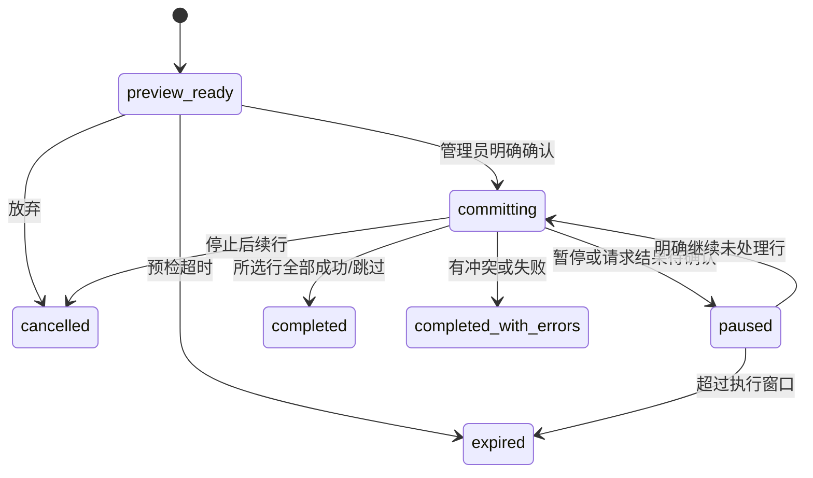

# Issue #84：Excel 批量开户与 OJ 资料导入完整设计方案

> 状态：功能已在 #84 任务分支实现并完成本地验证，继续使用草稿 PR #87，等待跨人评审与运维发布确认。首个提交仅为方案；当前实现及实际验证以第 21 章为准。
>
> 日期：2026-11-03（Asia/Shanghai）。关联 Issue：#84；父任务：#80；协作任务：#83 账号注销、#85 账号管理逻辑与 UI 优化。
>
> 交付方式：保留独立目录和 `feat/issue-84-excel-account-import`，继续更新关联 #84 的草稿 PR #87。用户于 2026-11-03 明确要求“实现他”，本次在原方案基础上实施、测试及更新现有 PR，不合并或发布。

## 目录

1. [目标、范围与现状](#1-目标范围与现状)
2. [总体方案与关键决策](#2-总体方案与关键决策)
3. [模板字段与数据规则](#3-模板字段与数据规则)
4. [Excel 解析与上传防护](#4-excel-解析与上传防护)
5. [前端页面与交互](#5-前端页面与交互)
6. [模块职责与技术结构](#6-模块职责与技术结构)
7. [数据模型与保留规则](#7-数据模型与保留规则)
8. [状态机、事务与并发](#8-状态机事务与并发)
9. [接口契约](#9-接口契约)
10. [初始凭据领取与响应丢失](#10-初始凭据领取与响应丢失)
11. [OJ 绑定、同步及注销协作](#11-oj-绑定同步及注销协作)
12. [效率、容量与观测](#12-效率容量与观测)
13. [错误码与失败交互](#13-错误码与失败交互)
14. [测试矩阵与验收](#14-测试矩阵与验收)
15. [分阶段实现与 PR 组织](#15-分阶段实现与-pr-组织)
16. [发布、迁移与恢复](#16-发布迁移与恢复)
17. [拟修改文件](#17-拟修改文件)
18. [Git 执行方式与已授权范围](#18-git-执行方式与已授权范围)
19. [决策检查与已完成工作](#19-决策检查与已完成工作)
20. [代码依据与官方参考](#20-代码依据与官方参考)
21. [实施记录与验证](#21-实施记录与验证)

## 1. 目标、范围与现状

### 1.1 用户能完成什么

管理员下载模板，填入 QQ、成员资料及 OJ 账号，上传后先查看逐行校验结果和拟执行动作，确认后创建普通成员账号。系统分段反馈进度、逐行结果和初始凭据，成员使用初始凭据登录并按现有流程修改密码。

首期交付：

- 新成员：新建成员档案、创建 Web 普通成员账号、按管理员确认录入 OJ 标识。
- 已有成员但没有 Web 账号：只补开户，不修改已有档案和绑定。
- 已有 Web 账号、停用账号或不满足开户条件的对象：明确跳过/阻断，不覆盖原凭据和权限。
- 管理员在同一个工作台完成模板、预检、确认、进度、凭据领取和报告下载。

首期不开放已有资料批量覆盖、批量改绑、角色批量授予、CSV、自定义列映射、账号合并、密码找回。仅创建成员档案可保留扩展空间，首期必须先交付“建档并开户/补开户”的完整闭环。

### 1.2 核对版本与现有能力

本节保留方案撰写时的基线核对记录。功能实施已在独立本地目录进行，基于最新 `main` `34e21a9`（2026-11-03）；未复制原主目录 README 和 `docs/member-guide.md` 的既有改动。

核对时 GitHub `main`：`b0b5f5d1e7abb1c499c5f1e898a8bd0c499994ca`，提交时间 2026-11-03 14:01:54（北京时间）。正式建分支前仍需取得当时最新 `main`，复核新增改动。

| 已确认现状 | 对方案的影响 |
| --- | --- |
| Vue 3、Vue Router、Vite；前端统一管理中心已有 `accounts` 和 `members` 模块 | 复用管理工作台和现有样式，不新增独立后台 |
| Quart、aiosqlite、SQLite；上传请求总大小当前上限 6 MiB | 导入文件上限低于 6 MiB，保留 multipart 开销 |
| `users` 和 `web_accounts` 分开保存 | 必须区分新成员、已有成员未开户、已有登录账号 |
| `POST /api/admin/web-accounts/batch` 只接收已有 QQ 列表，每次 1–20 人 | 抽出共享开户服务；不把 Excel 的全流程简单拼成前端循环调用旧接口 |
| 密码哈希是 PBKDF2-SHA256、600,000 轮；当前批量接口同步计算哈希 | 哈希移到有界执行器，写事务内不进行密码计算 |
| 临时密码有效期、首次登录改密、凭据版本与会话失效已经存在 | 复用现有认证规则；新导入初始密码采用强随机字符串 |
| Web admin/root 可管理账号；旧共享管理员登录也可能被识别为 root | 新导入建议要求可追溯的个人 Web 管理账号 |
| 绑定写入已有 `apply_binding`、审计及版本触发器 | 导入复用绑定服务，不手工设置绑定版本 |
| `status` 当前是“身份/年级”文本，未发现统一的硬编码身份枚举 | 不把“现役”等身份误当权限；新身份值在预检中提示确认 |
| API 工具已支持 `FormData`、CSRF、会话代次；默认超时 15 秒 | 上传复用现有工具，提交分段并配置适当超时 |
| requirements 当前没有 Excel 解析库 | 后端新增并锁定经过验证的 `openpyxl` 与 `defusedxml` 依赖 |

### 1.3 权限与业务边界

所有导入接口都在服务端检查 admin/root，所有写接口校验 CSRF。新账号角色固定为 `member`；不接收表格中的 Web 角色、密码、管理权限或机器人管理员配置。

建议新导入仅对具名 Web 管理账号开放；旧共享 root 登录仍保留原有其他操作。原因是导入包含个人资料和初始凭据，批次需要稳定的操作者归属。现已落实为服务端权限规则，旧共享 root 的原有其他功能保留。

## 2. 总体方案与关键决策

### 2.1 推荐结构

采用“后端解析、服务端持久预检、人工确认、小批次提交、明文凭据仅当次返回”的方案。


### 2.2 为什么采用这个方案

| 决策 | 具体行为 |
| --- | --- |
| 后端统一解析 | 浏览器不引入 Excel 解析依赖；前后端不各自维护校验规则 |
| 预检可持久恢复 | 刷新后能恢复校验结果和业务进度；预检只写导入元数据，不创建真实成员 |
| 每段默认 10、人数字段硬上限 20 | 减少长请求，沿用已有批量开户的规模边界；最终按服务器实测调整 |
| 每行原子提交 | 成员、账号、绑定、来源记录和该行成功状态在一个事务中完成 |
| 允许部分成功 | 某行冲突不抹掉其他已成功行；每行结果明确 |
| 明文初始密码不持久化 | 只存密码哈希；本次响应丢失时查询状态，再由管理员明确重发 |
| 现有成员只补开户 | 所有被忽略的资料/OJ 字段在预览中列明，避免误以为已经导入 |
| 导入来源与本人验证分开 | 能显示“管理员录入”，不伪造 OJ 本人归属验证 |
| 自动同步默认关闭 | 开户完成不依赖外部 OJ；后续复用受控同步入口 |

### 2.3 处理矩阵

| 服务端实际状态 | 预检动作 | 提交时行为 |
| --- | --- | --- |
| QQ 不存在，字段合法 | `create_member_and_account` | 创建档案、普通账号和确认的 OJ 绑定 |
| 成员存在，没有 Web 账号 | `create_web_account_only` | 只创建普通账号，原资料和 OJ 完全保留 |
| Web 账号已存在且启用 | `skip_existing_account` | 不开户、不重置、不覆盖 |
| Web 账号已存在且停用 | `blocked_inactive` | 不自动启用 |
| 已有注销状态/注销阻断记录 | `blocked_closed` | 不恢复；按 #83 的统一判定 |
| 表内 QQ 重复 | `invalid_duplicate_qq` | 同组重复行全部不可提交，不自动选择第一行 |
| 拟写入 OJ 被其他成员占用或表内重复 | `invalid_binding_conflict` | 整行阻断，修正后重新上传 |
| Excel 字段不合法 | `invalid_fields` | 整行阻断，显示行号和字段原因 |
| 预检后成员/绑定/账号状态变化 | `conflict_source_changed` | 不悄悄变换执行动作，要求重新预检 |

对于已有成员未开户的行，表中 OJ 字段属于忽略项，不对“不会写入的值”执行占用冲突阻断；预览必须清楚展示实际会保留哪个现有绑定。

## 3. 模板字段与数据规则

### 3.1 工作簿结构

模板包含三个受控工作表：

1. `填写说明`：字段说明、示例和敏感信息提醒。
2. `成员导入`：第 1 行为固定中文表头，第 2 行起是数据。
3. `_meta`：只包含模板版本等声明；作为兼容性提示，不作为可信授权或签名。

模板版本建议 `account-import-v1`。模板中没有真实成员、OJ 密码、Cookie、Token 或统一初始密码。

### 3.2 字段表

| 列名 | 字段 | 必填 | 规则和默认值 |
| --- | --- | --- | --- |
| QQ号 | `qq_id` | 是 | 按现有 QQ 校验，4–12 位数字；模板单元格设置为文本 |
| 昵称 | `name` | 否 | 新成员空值使用 QQ 作为展示名；建议上限 100 字符，不使用真实姓名回填 |
| 姓名 | `real_name` | 否 | 上限 128 字符；仅按既有本人/管理员资料权限使用 |
| 身份 | `status` | 否 | 上限 64 字符；空值保留空，不默认为现役；不授予管理权限 |
| 学校 | `school` | 否 | 上限 128 字符；只去除首尾空白 |
| Codeforces账号 | `cf_handle` | 否 | 复用 `normalize_account('codeforces', value)` |
| 洛谷UID | `luogu_id` | 否 | 复用现有正整数 ID 规则，按文本保存 |
| 牛客UID | `nowcoder_id` | 否 | 同上，不填写昵称或主页 URL |
| AtCoder账号 | `atcoder_handle` | 否 | 复用现有平台校验，不写主页 URL |
| 校OJ账号 | `cjlu_username` | 否 | 复用现有校 OJ 账号标识校验，不接收登录密码 |

字段长度需在共享校验层显式报错，不沿用 `_field` 静默截断的方式。现有不同入口的昵称长度存在差异，本期新增入口采用较严格边界，旧入口兼容性单独验证，不扩大到全项目资料规则重构。

### 3.3 文本、数字和异常单元格

- QQ、UID 推荐始终以文本填写。合法文本只 trim，不擅自删除中间空格、不进行模糊纠错。
- 数字型 QQ 仅在能够证明为有限、精确整数且符合现有长度规则时转换为十进制文本，并提示模板建议；不能猜测已经丢失的前导零。
- 数字型 OJ UID 超过 Excel 可靠的十进制有效位范围时拒绝，要求改为文本重新填写。不能根据浮点显示猜回原 ID。
- 字符串形式的科学计数法、不合法小数、日期、布尔值、错误值及公式不按 QQ/OJ 标识接受。
- 对 handle 类字段不把数字值隐式当成用户名；需要用户以文本明确填写。
- 完全空白行忽略；部分填写但 QQ 为空的行报错。每一条结果保留真实 Excel 行号。
- 相同列重复、缺少模板列、额外权限/密码列、未知工作表、合并的数据单元格和不支持的版本均给出明确错误。
- 已有成员补开户时即使上传了姓名、学校或 OJ 新值，也只作为忽略项展示，不保存。
- 当前身份是文本；首次出现的新身份值给出警告，管理员确认后才采用，避免把输入错误悄悄写成新身份类别。

### 3.4 规范化与占用检查

OJ 校验、平台别名、字段名和绑定版本统一从现有绑定服务获取。对当前 ASCII 账号标识采用与现有版本检查一致的 trim、忽略大小写比较规则；保存原合法展示值。

预检批量读取所需 QQ 和 OJ 占用信息，提交时在写事务中再次检查。不能只依靠预检时的“未占用”结果。当前无全平台唯一约束的能力不得凭空写成已存在；导入不得引入新占用冲突，历史重复数据单独报告，不在本任务擅自合并或清除。

## 4. Excel 解析与上传防护

### 4.1 依赖与执行方式

新增后端 `openpyxl` 与 `defusedxml`，实现时核对受维护版本、依赖兼容和已知问题后锁定具体版本。前端不增加表格解析包。

推荐流程：

1. 先完成会话、角色、CSRF、导入开关和上传大小检查。
2. 将受限文件写入不对外暴露的临时目录，不使用用户文件名作为路径。
3. 在有并发限制、可终止的解析子进程中检查 ZIP、XML 和工作簿。
4. 通过结构化 JSON 返回规范化字段和错误，禁止执行工作簿代码。
5. 主进程再次检查解析结果结构、数量和字符串上限，再写入预检批次。
6. 删除原始上传文件；崩溃遗留由受控清理任务按期限处理。

不把 `asyncio.wait_for(to_thread(...))` 当作能够终止恶意解析的隔离措施：超时返回不代表后台线程已经停止。解析超时必须能终止实际子进程并回收资源。

### 4.2 建议初始限制

下表限制已落实。实际容量测量见第 21 章；这是本地合成结果，不代表生产容量。

| 项目 | 建议值 |
| --- | --- |
| 单文件大小 | 5 MiB，低于当前 HTTP 总请求 6 MiB |
| 非空数据行 | 200 行；空白/样式膨胀也受 XML 资源边界限制 |
| 数据列 | 固定 10 列 |
| ZIP 条目 | 最多 256 个 |
| 实际累计解压字节 | 最多 32 MiB；不只信任 ZIP 元数据的声明大小 |
| 单个 XML 条目 | 最多 8 MiB |
| ZIP 路径 | 拒绝绝对路径、上级穿越和重复危险条目 |
| 单次解析墙钟时间 | 8 秒，超时终止子进程 |
| 解析并发 | 每个 API 进程最多 1 个，超额请求明确反馈 |
| 预检有效期 | 30 分钟 |

超限时说明具体可以修正的条件，例如“超过 200 行，请拆分表格”；不暴露内部路径、栈、成员占用者的无关个人信息。

### 4.3 内容检查

- 扩展名只接受 `.xlsx`，同时检查实际 ZIP/OOXML 结构，不能只相信浏览器 MIME。
- 拒绝 VBA、宏、外部链接、嵌入对象和其他非模板内容；`keep_links=False` 不能单独替代拒绝外部关系的检查。
- 使用安全 XML 处理，禁止 DTD/实体扩展，测试时确认安全解析路径实际启用。
- 在限制内逐条检查工作簿相关 XML 的实际行、单元格、字符串和公式，不信任伪造的 dimension 声明。
- `openpyxl` 使用只读模式，保留公式类型以便拒绝；不能用读取缓存结果的方式把公式当普通文本。
- 固定模板之外的隐藏工作表/行列内容不得作为隐藏的额外写入来源。
- 文件解析失败不创建真实用户，也不生成初始凭据。

## 5. 前端页面与交互

### 5.1 路由与职责

复用 `/admin.html?section=accounts`，增加受控页签 `tab=import`。批次恢复使用随机 `import_id`，地址中不放 QQ、姓名、密码或文件内容。

建议地址：

- 入口：`/admin.html?section=accounts&tab=import`。
- 恢复：`/admin.html?section=accounts&tab=import&import_id=<opaque-id>`。

只允许已知页签/步骤，异常参数回到导入起始页并提示。导入专用页面属于 #84；整个账号列表重排和通用 UI 改造属于 #85。

### 5.2 页面一：上传

```text
成员账号                       [账号列表] [Excel 导入]
────────────────────────────────────────────────────
Excel 批量开户
下载模板 → 上传校验 → 确认创建 → 领取结果

[下载 Excel 模板]   支持 QQ 与五个平台的账号标识
┌──────────────────────────────────────────────────┐
│ 拖入或选择 .xlsx 文件                             │
│ 最多 200 行、5 MiB；不要填写任何 OJ 密码           │
└──────────────────────────────────────────────────┘
已有成员只补开户，已有密码与资料不会被覆盖。
                                      [上传并校验]
```

上传时只显示解析进度/状态，不伪造无法测量的百分比。文件名作为普通文本渲染，失败后可以重新选择文件。

### 5.3 页面二：预览与确认

```text
校验结果：共 100 行｜可创建 76｜补开户 10｜已存在 8｜错误 6
[全部] [可执行] [需要确认] [已跳过] [错误]

选择  Excel行  QQ号        昵称      动作          说明
[✓]      2    12345678     同学A     新建并开户    OJ 由管理员录入
[✓]      3    23456789     同学B     仅补开户      保留已有资料和绑定
[—]      4    34567890     同学C     已有账号      不重置原密码
[—]      5    ……           ……        无法导入      洛谷UID格式错误

已选择 86 人。[全选可执行行] [清空]
[ ] 我已核对将写入的 OJ 账号与对应成员
[下载无密码校验报告]  [重新上传]    [确认创建所选账号]
```

不能提交错误/跳过行；不能把隐藏在其他页的已选对象悄悄带入操作。所有选择由行 ID 表达，服务端重新验证所属批次和实际动作。

确认提示显示新建人数、补开户人数、被忽略的资料字段、初始密码有效期和首次改密要求。管理员对 OJ 的确认只表示代录依据，不等于本人平台归属验证。

### 5.4 页面三：执行与领取

```text
正在处理：60 / 86 人    成功 58｜冲突 2｜剩余 26
[当前段处理中……]      [暂停后续创建]

本次已收到的初始凭据
QQ号        昵称       初始密码             有效期
12345678    同学A      [受控显示]           ……

[复制已领取凭据] [下载凭据文本] [下载无密码结果报告]
离开或刷新后，已收到的明文密码不会保留。
```

提交期间允许暂停后续段；当前已经在处理的段不承诺撤销。成功、冲突、未知提交结果、已完成但未收到凭据分别展示。

普通结果报告由后端生成 `.xlsx`；初始凭据仅在浏览器当前页面内存中汇总，可本地生成纯文本下载，无需把密码再上传给服务器。

### 5.5 组件与状态

建议组件：`AccountImport.vue`、`ImportPreviewTable.vue`、`ImportResults.vue`，按实际复杂度拆分，避免单文件同时承担解析规则与全部表格逻辑。

浏览器只保存非敏感恢复状态：批次 ID、步骤、所选行、当前请求标识和结果计数。初始密码仅保存在导入页面当前实例内存中，不放入 URL、全局持久状态、localStorage、sessionStorage、错误采集或日志。

刷新后请求服务端恢复进度，但不恢复明文密码、不自动继续创建。管理员明确点击“继续未处理成员”后才提交后续段。

### 5.6 请求与离页处理

- 上传使用现有 API 工具的 `FormData` 路径，保留 Cookie、CSRF 和会话代次检查。
- 预检和提交设置与预算匹配的超时，例如 30 秒；超时后查询状态，不盲目重发写操作。
- 普通查询使用取消/响应代次保护，避免旧预检覆盖新文件。
- 当前管理容器主要在 `section` 变化时执行离页检查；导入还需覆盖 `accounts` 内页签切换、整页刷新及关闭。
- 只对会丢失凭据或放弃未完成操作的导航提示，不因表格筛选/分页频繁弹窗。
- 离页停止下一段和轮询，清理凭据内存；已经发出的写请求以服务端持久结果为准。
- 导出 Blob 接口需要补充现有 API 工具的二进制响应支持，复用其认证/错误处理，避免另写一套无会话检查的下载逻辑。

## 6. 模块职责与技术结构

```text
Vue 管理中心
  AccountImport.vue / 专用预览和结果组件
           │ FormData / JSON / Blob
           ▼
account_import_api.py       身份、CSRF、权限、HTTP 契约
           ▼
account_import_service.py   预检、选择冻结、分段、幂等、审计
      ├── account_import_excel.py   受限模板/解析/报告
      ├── web_account_service.py    共享开户与初始凭据
      ├── binding_service.py        绑定写入/版本/来源
      └── SQLite                   业务数据与导入台账
```

新增蓝图在 `/api` 下注册；不要把全部 Excel 解析和批次状态塞进已有 `backend_api.py`。

共享开户服务从现有单个和批量接口中提取可复用的校验/密码准备/事务内插入能力，不通过内部 HTTP 请求调用旧接口。旧接口的返回结构、批量上限和现有临时密码行为保持兼容，增加对应回归验证。

密码准备使用独立、有界执行器，建议每 API 进程 1 个哈希工作线程起步；不在事件循环直接执行整批 PBKDF2，也不把所有 HTTP 请求无限排进执行器。

## 7. 数据模型与保留规则

以下为逻辑设计，正式 DDL 需要结合项目初始化方式和最终状态命名实现，不能直接当作已存在的表。

### 7.1 导入批次 `account_import_batches`

主要字段：

- `id`：随机、不可枚举的批次 ID。
- `actor_qq_id`：具名管理员；操作时仍需检查当前角色和凭据状态。
- `template_version`、`file_sha256`、`normalized_sha256`：模板与内容识别；摘要不代替权限。
- `status`、`preview_version`、`selection_digest`：批次状态、预检版本、确认的操作范围。
- `total_rows`、`ready_rows`、`created_rows`、`skipped_rows`、`conflict_rows`：可重建的统计缓存。
- `created_at`、`preview_expires_at`、`confirmed_at`、`execution_expires_at`、`finished_at`、`payload_purge_at`。
- 必要的参数快照：初始凭据有效期、每段上限、管理员代录确认；不保存密码或原文件内容。

不要给操作者设置会随成员注销而连带删除所有审计记录的级联关系。保留/匿名化如何配合 #83，需要在其数据清单中明确。

### 7.2 逐行记录 `account_import_rows`

主要字段：

- `id`、`batch_id`、`excel_row_number`、`qq_id`。
- `action`：新建并开户、仅补开户、跳过或阻断。
- `status`：可提交、无效、已跳过、已创建、冲突、失败、已取消等。
- `normalized_payload_json`：受限字段，短期用于执行和报告；不包含密码。
- `source_snapshot_json` / `source_snapshot_hash`：预检时相关成员、账号及绑定状态。
- `warnings_json`、`errors_json`、`ignored_fields_json`。
- `chunk_id`、`result_code`、`created_account_at`、`attempt_count`、时间字段。

同批次 Excel 行号唯一。QQ 不作为该表的唯一键，因为重复行必须全部展示并报错。

### 7.3 提交段 `account_import_chunks`

主要字段：

- `id`、`batch_id`、`idempotency_key`、`request_hash`。
- `row_ids_json`、`status`、`lease_token`、`lease_generation`、`lease_until`。
- `result_json`：只有可重复查询的业务结果，不包含明文初始密码。
- `created_at`、`finished_at`、`interrupted_at`。

同批次幂等键唯一；同一批次同时只允许一个有效处理段。租约、状态和最终行结果都保存在 SQLite，不依赖某个 worker 的内存。

示意索引：

```sql
CREATE UNIQUE INDEX account_import_chunk_key
ON account_import_chunks(batch_id, idempotency_key);

CREATE UNIQUE INDEX account_import_one_processing_chunk
ON account_import_chunks(batch_id)
WHERE status = 'processing';

CREATE INDEX account_import_rows_by_state
ON account_import_rows(batch_id, status, excel_row_number);
```

上面的字段、状态和索引名在完整 DDL 评审时一并确定；不在旧数据未核查的情况下添加全库 OJ 唯一索引。

### 7.4 绑定来源 `binding_provenance`

导入的 OJ 标识需要持久来源，不能只依赖 24 小时后清理的导入明细。

建议字段：`qq_id`、`platform`、`binding_version`、`account_canonical`、`source`、`actor_qq_id`、`import_batch_id`、`recorded_at`、`owner_verified_at`、`existence_status`。后者初始为 `not_checked`，不能由格式校验推导为存在。

- 导入时 `source=admin_import`、`owner_verified_at=NULL`。
- 展示来源前校验当前账号与绑定版本匹配，不能把旧来源套给新绑定。
- 成员通过现有 CF 归属核验后，在同一事务记录 `member_verified`；即使验证的是同一个 handle，也要更新有效来源。
- 老绑定没有来源记录时显示未知，不回填虚假的本人验证结论。
- 绑定变化/注销后按统一生命周期处理；来源不能因导入明细到期而丢失。

### 7.5 建议保留与清理

| 内容 | 建议策略 |
| --- | --- |
| 原始 Excel 文件 | 解析完成即删除；异常遗留短期回收，不进入公开静态目录 |
| 未确认预检 | 30 分钟后不允许提交 |
| 已确认执行窗口 | 首次确认后 2 小时内，可显式继续未处理行 |
| 姓名、学校和原始规范化数据 | 终态后最多 24 小时供报告，之后清理导入副本 |
| 最小操作台账 | 建议 90 天，保留操作者、QQ、动作、结果和时间；最终由团队确定 |
| 明文初始密码 | 服务器不落库、不落磁盘、不进入日志或导入报告 |
| 绑定来源 | 与当前绑定生命周期一致，不按报告 TTL 清除 |

以上期限是产品/运维建议，尚未形成已实施政策。数据库备份中的历史资料另有保留周期，不能宣称删除运行库副本就等于已删除所有备份。

清理任务按小批次执行，不阻塞认证和业务写入。完成过的数据清理不能仅靠回退代码恢复。

## 8. 状态机、事务与并发

### 8.1 批次和行状态



“取消”只阻止尚未提交的操作，不删除已经创建的成员账号。数据库中的成功记录是事实来源，浏览器进度条不是事实来源。

行状态和报告必须区分：未处理、已创建、已有账号跳过、状态变化冲突、字段错误、暂时失败、取消。初始凭据是否在当前页面收到是另一维度，不能把“没收到密码”写成“开户失败”。

### 8.2 首次确认与选择冻结

首次提交时验证：

1. 当前具名 Web 管理员有权限且无需强制改密。
2. 批次属于该管理员、尚未过期、预检版本匹配。
3. 所选行全部属于此批次，确为可执行行；选择不是任意 QQ。
4. 涉及新 OJ 写入时已明确确认管理员代录。
5. 冻结所选行、动作和摘要；后续段不能偷偷加入其他行或改变资料。

同一文件再次上传可以提示该管理员已有未过期预检。跨管理员不能泄漏彼此批次。同文件或相同规范化内容再次形成新批次时，最终仍依靠数据库状态复核和账号唯一键防止重复创建。

### 8.3 分段执行

每段由服务端从冻结范围内选取下一组未处理行，默认 10 人、硬上限 20。客户端不能任意放大上限或自行改成另一组 QQ。

执行过程：

1. 短事务申请段、幂等键和租约，取得唯一处理权。
2. 在写事务外准备强随机密码和哈希；限制执行器和排队数量。
3. 每行开启短写事务，校验租约代次、批次仍可执行、管理员当前身份/凭据版本、目标成员及 OJ 最新状态。
4. 根据冻结动作执行新建或补开户，记录绑定来源、必要审计和该行成功状态。
5. 该行业务写入与台账状态一起提交；失败则该行回滚。
6. 释放事务后处理下一行，必要时续租；到达时间预算即停止启动新行。
7. 结束段状态，返回普通结果和本请求新创建账号的明文凭据；业务结果可重复查询，明文不可重放。

不能在 SQLite 写事务中做 Excel 解析、密码哈希、远程 OJ 请求、报告生成或文件下载。

### 8.4 并发与中断

- 同一个批次只能有一个处理段。不同批次争抢同一 QQ/OJ 时，写事务内复核，不相信旧预览。
- 初始租约建议 90 秒，并使用代次/随机令牌作为 fencing 条件；过期旧处理者即使恢复也不能继续提交。
- 操作者在处理中被停用、降权、注销或凭据版本变化时，后续行停止；序列化敏感结果前再核对权限。
- 预检时不存在的成员若已由其他入口建档，不自动转成“只补开户”，因为管理员确认的动作发生变化；返回冲突并重新预检。
- 进程在某行事务中退出，该行回滚；已经提交的行保留成功状态。租约过期后段标记为中断，未完成行可在新的显式继续操作中处理。
- 并发保护依靠数据库条件和唯一约束；进程内 asyncio 锁只用于节流，不能代替跨 worker 正确性。
- SQLite 忙或其他暂时故障不触发无限重试。记录可重试状态并停止当前段，管理员确认后再处理未成功行。

### 8.5 幂等结果

| 请求情况 | 返回行为 |
| --- | --- |
| 新幂等键、合法操作 | 执行该段并返回本次新凭据 |
| 同键、同内容、仍处理 | `202`，返回段状态和查询方式，不再开户 |
| 同键、同内容、已结束 | 返回已保存的无密码结果，明确 `credentials_replayed=false` |
| 同键、不同内容 | `409 idempotency_conflict` |
| 上次进程中断、部分行已成功 | 返回已知结果；明确继续只处理未成功且仍合法的行 |
| 新批次重复导入已创建 QQ | 已有账号跳过，不自动重置密码 |

段中的敏感凭据只属于执行该段的原始请求内存，不放入持久幂等结果，也不放入一般响应缓存。

## 9. 接口契约

### 9.1 接口总表

所有路径均以 `/api` 为前缀。下列接口已实现，最终字段和错误处理见 [api.md（正式接口）](api.md#excel-批量开户与-oj-资料导入)。

| 方法与路径 | 用途 | 主要约束 |
| --- | --- | --- |
| `GET /admin/account-imports/capabilities` | 读取开关、模板版本、容量和身份建议 | 具名 admin/root；不返回他人导入数据 |
| `GET /admin/account-imports/template` | 下载模板 | 固定文件名、Excel MIME、受控缓存策略 |
| `POST /admin/account-imports/preview` | 上传并创建预检 | `multipart/form-data`、CSRF；仅导入元数据写入 |
| `GET /admin/account-imports/{id}` | 恢复摘要和进度 | 默认仅所有者；root 可按审计权限只读查看 |
| `GET /admin/account-imports/{id}/rows` | 分页查看逐行结果 | `status/page/page_size`；最大 100 行一页 |
| `POST /admin/account-imports/{id}/commit` | 确认范围并处理下一段 | CSRF、版本、幂等、代录确认、租约 |
| `POST /admin/account-imports/{id}/cancel` | 停止后续行 | CSRF；保留已经成功的账号 |
| `GET /admin/account-imports/{id}/report` | 下载校验或执行报告 | 仅授权范围；不包含明文密码 |

root 不通过接管其他操作者批次获得原始密码。需要重新发放时使用现有受控密码重发/重置流程并留下审计。

### 9.2 预检请求与响应

上传只允许一个 `file` 文件字段，拒绝额外的角色、密码、映射或其他未声明字段；服务端最终决定模板版本是否兼容。客户端传入的表头映射、角色或“已校验”标记不作为可信输入。

```json
{
  "id": "opaque-batch-id",
  "template_version": "account-import-v1",
  "preview_version": 1,
  "status": "preview_ready",
  "expires_at": 1793700000,
  "summary": {
    "total": 100,
    "create_member_and_account": 76,
    "create_web_account_only": 10,
    "skipped": 8,
    "invalid": 6
  },
  "rows_url": "/api/admin/account-imports/opaque-batch-id/rows"
}
```

上述时间和数量仅是接口形状示例，不是实际测试结果。

逐行响应包含 `row_id`、`excel_row_number`、`qq_id`、实际展示名、动作、可提交标志、错误/警告/忽略字段。只返回该界面需要的资料，不把数据库整行直接序列化。

### 9.3 首次确认请求

```json
{
  "preview_version": 1,
  "selected_row_ids": ["row-a", "row-b"],
  "acknowledge_admin_binding": true,
  "idempotency_key": "random-request-key"
}
```

服务器冻结完整选择并仅处理第一段。后续请求提供服务端返回的范围摘要和下一段标识；标识还必须匹配操作者、有效批次及实际待处理范围。

```json
{
  "preview_version": 1,
  "selection_digest": "server-confirmed-selection-digest",
  "continuation_token": "opaque-next-chunk-token",
  "idempotency_key": "another-random-request-key"
}
```

服务端生成/持久化下一段标识；客户端不能通过更换 token 或幂等键绕过同批次单段限制。

### 9.4 提交响应

```json
{
  "id": "opaque-batch-id",
  "chunk_id": "opaque-chunk-id",
  "status": "committing",
  "processed": 1,
  "results": [
    {"row_id": "row-a", "qq_id": "12345678", "result": "created"}
  ],
  "credentials": [
    {
      "row_id": "row-a",
      "qq_id": "12345678",
      "name": "示例成员",
      "temporary_password": "示例占位，不是真实密码",
      "expires_at": 1793700000
    }
  ],
  "credentials_replayed": false,
  "next_chunk_token": "opaque-next-chunk-token"
}
```

`processed` 是本段实际终态行数；示例本段处理 1 行，若仍有待处理行则返回下一段标识。正式契约测试必须验证逐行数量、累计计数和剩余范围一致。

`credentials` 仅原始执行请求返回。幂等重试、摘要、逐行查询和报告均不返回该字段或返回空数组，并明确“本次未重放密码”。服务器只能知道凭据已被放入响应，不能据此断言客户端实际收到了密码。

### 9.5 下载与缓存

所有含个人资料、导入结果和凭据的响应使用 `Cache-Control: no-store`；涉及登录身份的响应不由共享缓存复用。下载设置正确的 `Content-Type`、安全文件名和 `nosniff`。

报告全部用户可控内容按 Excel 字符串单元格输出；测试确保不存在由用户值生成的公式、外部引用或超链接关系。初始凭据下载在本地生成纯文本，按钮文案明确“含初始密码，请妥善转交”。

## 10. 初始凭据领取与响应丢失

### 10.1 初始密码策略

- 新导入使用密码学随机源生成至少满足现有密码验证规则的字符串，例如基于 `secrets` 的 24 字符随机材料，必要时重采样使字符类别满足校验。
- 每个账号独立生成；不能统一密码、基于 QQ 推导或复用同批次密码。
- 复用现有哈希算法和登录验证，不降低迭代次数。
- 复用现有 `webui_temporary_password_ttl_hours` 配置，当前默认 72 小时；到期、首次登录强制改密和会话失效机制一致。
- 现有旧批量接口的六位临时码行为不在本任务中无条件全局替换；新增强随机导入策略和旧行为分别验证。

### 10.2 网络结果不确定时

以“数据库开户成功，HTTP 响应丢失”为例：

1. 页面超时，不自动换幂等键重新创建。
2. 通过批次/段状态查询确认哪些账号已经成功。
3. 成功行保持成功，显示“账号已创建，当前页面未收到初始密码”。
4. 管理员核对这些行后，使用已有的临时密码重发/重置入口显式重新生成；原密码失效并记录操作。
5. 原请求重试只返回台账，不读取或推算旧密码。

这是“明文不持久化”的明确恢复边界。首期不引入新的凭据加密存储、临时下载密钥或可反复领取明文的服务端库。

### 10.3 关键失败边界

| 失败点 | 数据与恢复 |
| --- | --- |
| 生成哈希前失败 | 没有创建账号，可重新提交未处理行 |
| 行事务提交前失败 | 该行回滚，其他成功行保留 |
| 事务已提交但响应未收到 | 查询成功状态，显式重发缺失凭据 |
| 页面刷新/关闭 | 明文丢失，只恢复无密码进度 |
| 管理员失去权限 | 不继续下发敏感信息，由有权限人员处理后续 |
| 批次过期 | 不继续旧批次，按当前数据库重新预检 |

## 11. OJ 绑定、同步及注销协作

### 11.1 新成员 OJ 导入

新成员的 OJ 字段在预检中进行格式、同表重复和当前数据库占用检查。确认时服务端再次检查，并由现有绑定服务在行事务中写入，触发既有版本和证据处理逻辑。

先以空 OJ 字段创建成员，再在同事务调用共享绑定函数，确保真实绑定版本由既有机制生成，不在插入时绕过触发器并手工猜测版本。新成员不应该有旧提交证据；若发现异常关联数据，阻断并报告，不删除来历不明的历史数据后继续开户。

管理员明确确认的是录入对应关系，持久来源为 `admin_import`。不填写本人核验时间，不显示“已通过本人验证”。

### 11.2 已有成员补开户

保留全部现有成员资料与 OJ 字段。Excel 中不同的昵称、姓名、学校或 OJ 账号在预览里列为忽略项；补开户不能触发旧账号提交证据清理、绑定改动或同步游标重置。

即使已有字段为空，也不在本期默认补写，避免“补开户”隐含“修改资料”。后续批量更新由父任务另行建设。

### 11.3 平台存在性与本人归属

格式正确、账号存在、管理员代录确认和本人归属验证是不同状态。首期不把外部 OJ 请求放进开户事务，也不把存在性查询成功等同于归属已确认。

CF 成员后续可以沿用现有资料验证码流程完成本人核验。其他平台当前网页没有完整自主核验能力的，不在导入中伪造；继续按管理员维护路径处理。

绑定摘要新增兼容字段表达来源/归属状态，保留现有 `binding_status`、`self_service` 等字段含义。个人中心仅对导入来源增加必要提示，不顺带重做完整个人中心。

### 11.4 同步

首期不自动触发全文件全平台同步。开户成功后可从现有受控同步入口操作；需展示“已录入、尚未同步”，不能把未同步统计显示成账号不存在。

若后续决定提供导入后同步按钮，应复用 `_account_sync_submitter` 和现有队列、绑定快照、并发/限频机制。同步结果与开户结果分开，调度或外部平台失败不撤销已成功账号。

### 11.5 与 #83 的开户可用性判定

方案初稿基线没有注销模型。当前实现采用第 21 章的兼容边界：main 无注销列仍可运行，存在 #83 的真实生命周期列时冻结 epoch、阻断 closed 并在注销事务内脱敏。

- #84 先复用现有账号存在、停用和角色校验。
- 与 #83 约定共享的 `account_creation_eligibility(db, qq_id)` 之类服务边界；具体命名在实现前确认。
- 系统实际启用注销功能前，导入必须接入相同注销/重入会规则，并增加“已注销 QQ 重导入不恢复”的联调测试。
- 若 #83 尚未上线，可以先交付 #84 的现有状态闭环；不能因此声称已验收不存在的注销场景。
- #83 后续删除/匿名化导入记录、绑定来源与操作者资料时，应覆盖本方案新增表。

## 12. 效率、容量与观测

### 12.1 已做的隔离计算实验

仅用随机合成输入运行本机 Python 3.12.14 的 PBKDF2-SHA256、600,000 轮：

| 指标 | 结果 |
| --- | --- |
| 六次耗时（ms） | 231.96、236.08、232.58、208.86、205.24、219.62 |
| 中位数 | 225.79 ms/次 |
| 10 次串行估算 | 约 2.26 秒 |
| 20 次串行估算 | 约 4.52 秒 |

这不是完整 API、生产机器或并发吞吐数据，未包含解析、数据库、调度和网络。它只说明不能把数百次哈希简单塞进一个长请求，更不能承诺“大批开户瞬间完成”。

### 12.2 性能措施

- 默认每段 10 人，客户端串行提交段；整批进度及时更新。
- 哈希在事务外、有界执行，登录等其他请求不与导入无限争抢默认线程池。
- 预检按平台/QQ 批量读取，避开每行每字段一次数据库连接的模式。
- 逐行短事务，报告在事务外生成；数据库忙时停止扩散重试。
- parser 并发、哈希并发是每进程限制；多 worker 总并发还需结合部署数量和数据库配额测量，不声称一个进程的 semaphore 就是全局限制。
- 原文件、XML、行数、字段长度、预检并发和批次有效期均有明确边界。

### 12.3 实施时记录的指标

记录请求/批次关联 ID、解析耗时、行数、有效行/冲突数、哈希耗时、每段耗时、事务等待与提交耗时、暂时故障和响应未知次数。

禁止记录原 Excel 内容、完整凭据、Cookie、Token 或请求体快照。文件名和姓名不作为常规日志字段。

压测组合：1/10/20/100/200 行；全新成员、已有账号、混合错误、多平台、两个管理员并发、服务重启和慢网络。在同一环境测量导入期间 `/auth/me` 等常规请求的延迟和错误率，再确定正式容量与时间预算。

## 13. 错误码与失败交互

| 状态/错误码 | 界面行为 |
| --- | --- |
| `401` | 回登录；保留允许恢复的批次 ID，不保留密码 |
| `403 forbidden` / `named_admin_required` | 说明没有权限或需使用具名 Web 管理账号 |
| `404 import_not_found` | 不暴露无权限批次是否存在 |
| `409 source_changed` | 列出受影响行，要求重新预检 |
| `409 idempotency_conflict` | 停止自动提交，重新读取当前状态 |
| `409 import_in_progress` / `202 processing` | 当前段仍在处理，查询状态，不重复创建 |
| `410 preview_expired` | 提示重新上传或预检 |
| `413 file_too_large` | 显示文件上限，不出现默认 HTML 错误页 |
| `415 unsupported_file_type` | 提示仅使用 `.xlsx` 模板 |
| `400 invalid_workbook` / `invalid_template` | 文件结构错误，提供具体可修正原因 |
| `422 invalid_selection` | 选择与预检不一致，不执行 |
| `429 import_rate_limited` | 提示稍后再试，不自动循环重传文件 |
| `503 import_disabled` / `parser_busy` | 功能暂不可用或系统繁忙；已生成结果仍按权限查询 |
| `database_busy` | 停止本段后续行，显示已成功结果与待处理范围 |
| 网络超时/中断 | 显示“正在确认结果”，只查询状态 |

单行字段错误使用结构化 `field/code/message`；错误文案不包含 SQL、路径和堆栈。有效工作簿即使所有行均不可提交，也可建立只读预检结果供下载，不用空白页面表示失败。

## 14. 测试矩阵与验收

本章为验收矩阵，实际运行数量和结果见第 21 章；不能仅按本表推断全部生产验收通过。验证使用独立临时数据库、合成成员和受控响应，不修改生产成员或真实外部账号资料。

### 14.1 后端核心用例

| 编号 | 场景 | 必须验证 |
| --- | --- | --- |
| A01 | 匿名、普通成员、需改密账号 | 所有管理写入口由服务端拒绝 |
| A02 | admin/root 与共享旧登录 | 具名操作者规则正确，无表格提权 |
| A03 | CSRF 缺失或不正确 | 不解析/提交业务数据 |
| A04 | 猜测他人批次、段或行 ID | 不泄漏、不接管、不写入 |
| X01 | 标准模板与五个平台 | 解析正确，行号与规范化一致 |
| X02 | 缺列、重列、未知列、旧版本 | 明确拒绝，无业务写入 |
| X03 | 数字 QQ、长 UID、前导零、科学计数 | 不猜测丢失信息，按规则接受/拒绝 |
| X04 | 空行、部分空行、错误/日期/布尔单元格 | 结果及真实 Excel 行号正确 |
| X05 | 公式、宏、外链、隐藏数据、ZIP/XML 异常 | 在解析防线拒绝，不执行内容 |
| X06 | ZIP 膨胀、伪 dimension、超时 | 实际资源受限，解析进程可终止 |
| P01 | 上传/预检成功但不提交 | `users/web_accounts` 和同步均未变化 |
| P02 | 表内 QQ/OJ 重复、库内占用 | 所有冲突行明确，不隐式选择赢家 |
| P03 | 已有成员无账号 | 只补开户；原资料、绑定、证据和游标不变 |
| P04 | 新成员空昵称、不同身份 | 默认值正确，身份不影响角色 |
| P05 | 已有/停用账号 | 不重置、不启用、不提升权限 |
| C01 | 新建并开户，包含多个 OJ | 档案、账号、来源、台账原子提交 |
| C02 | 中途字段/数据库错误 | 失败行回滚，其他已成功行准确保留 |
| C03 | 预检后成员/绑定变化 | 不按旧预览覆盖新状态 |
| C04 | 同幂等键同/异内容 | 防重与冲突行为符合契约 |
| C05 | 两个管理员并发导入相同 QQ/OJ | 只有符合最新状态的写入成功，无重复账号 |
| C06 | 旧处理者租约到期后恢复 | fencing 校验阻止迟到提交 |
| C07 | 进程在任意行前后退出 | 事务与行结果一致，可恢复未处理范围 |
| C08 | 管理员处理中被降权/停用 | 后续行停止，不继续发放敏感信息 |
| C09 | 重复上传已完成文件 | 账号跳过，不再发放旧密码 |
| K01 | 强随机密码、有效期、首次改密 | 现有认证能完整完成首次登录闭环 |
| K02 | 成功后响应丢失或重复请求 | 查询状态，无密码重放，无自动重置 |
| K03 | 日志、数据库、报告、缓存 | 无明文初始密码泄漏 |
| B01 | 导入来源和本人核验 | 来源不冒充验证；同 handle 核验可更新来源 |
| B02 | 已有成员补开户 | 不触发绑定变化及证据清理 |
| B03 | 绑定/注销变化后的迟到同步 | 复用既有版本保护，旧结果不回写 |
| R01 | 结果报告含 `= + - @` 等用户输入 | 强制字符串，无公式/外链关系 |
| R02 | 导入明细过期和清理 | 期限、权限、脱敏和业务数据边界正确 |

#83 若尚未实现，B03 中“注销”部分标注为联调待验收；不得用模拟 stub 通过代替实际注销集成。

### 14.2 前端与浏览器

- 管理员完成模板下载、上传、筛选、选择、确认、分段执行、领取凭据、下载报告、成员首次登录改密。
- 有错误行仍能查看并明确选择合法行；补开户的忽略字段不能被误读成已更新。
- 快速换文件、反复筛选、路由刷新和前进后退不出现旧数据覆盖或重复开户。
- 段超时后进入结果确认，查询完成行；不自动改用新请求重复执行。
- 暂停、继续、离页、整页刷新、关闭、账号切换时，对未处理行和初始密码的处理一致。
- 当前用户不可访问其他管理员批次，不会在重新登录后看到前一用户的凭据内存。
- 文件过大、错误格式、解析超时、网络失败、会话过期、复制失败和下载失败均有可恢复反馈。
- 桌面/窄屏下表格、按钮、确认步骤和键盘焦点可用；不依靠颜色传达失败原因。
- 现有账号列表、单个创建、批量发放、重置/启停/角色修改及成员资料维护正常。

### 14.3 已有项目检查入口

实施时按项目实际环境执行并记录：

```powershell
python -m unittest discover -s feat/api/tests -p "test_*.py"
```

在 `feat/web` 目录执行：

```powershell
pnpm test
pnpm build
```

现有旧版 Web 单元检查按仓库脚本继续执行：

```powershell
node --test feat/api/tests/admin-history.test.cjs feat/api/tests/admin-problem-sync.test.cjs feat/api/tests/cf-sync.test.cjs feat/api/tests/theme-colors.test.cjs feat/api/tests/theme-performance.test.cjs
```

新增导入用例优先放独立测试文件，并针对核心权限、原子性、重试和恢复。浏览器验收复用现有 Playwright/受控演示环境；具体运行脚本和依赖以任务分支为准，不把本地旧构建验收当成最新源码验收。

### 14.4 Issue #84 验收映射

| Issue 要求 | 本文位置 |
| --- | --- |
| Excel 全链路与五个平台字段 | 第 3、5、9、11 章 |
| 预检不开户、显示逐行原因 | 第 3、8、9 章 |
| admin/root、无提权、无覆盖 | 第 1、2、8 章 |
| 重复、并发、超时、部分失败 | 第 8、10、13 章 |
| 凭据安全、有效期和首次改密 | 第 9、10、14 章 |
| 外部 OJ 不阻塞开户 | 第 8、11 章 |
| 资源限额及实际性能记录 | 第 4、12 章 |
| 现有账号与绑定流程回归 | 第 6、11、14 章 |

## 15. 分阶段实现与 PR 组织

### 阶段 0：创建方案草稿 PR

用户已同意以下首个文档提交与草稿 PR 流程：

- 在独立工作目录建立 `feat/issue-84-excel-account-import`，基于获取到的最新 `origin/main`。
- 仅新增 `docs/issue-84-account-import.md`，并更新根 README 的文档入口。
- 创建以 `main` 为目标的草稿 PR，标题建议“feat(accounts): Excel 批量开户与 OJ 资料导入”。
- PR 正文写 `Closes #84` 建立开发关联，同时明确“目前仅方案、尚未满足功能验收、保持草稿，不合并”。
- 先核对 GitHub 显示的 base/head、提交内容、草稿状态与 Issue 关联，再向用户交付 PR 链接。

`Closes #84` 只有在未来符合条件并合入默认分支时才应产生关闭效果；方案阶段不能提前把 #84 标记完成，也不能把只含文档的草稿改为可合并。

### 阶段 1：共享服务与兼容基础

提取开户能力，明确身份/字段校验、哈希执行器和事务边界。补充旧接口兼容回归，再引入新导入能力；避免直接复制旧接口形成两份逐渐分叉的逻辑。

交付判断：既有单个/批量开户和账号管理行为仍能通过正式测试；没有新的导入公开入口承诺。

### 阶段 2：模板、解析与预检

实现模板生成、安全解析、预检持久化、行分类、报告和容量限制。测试恶意/异常文件、无业务写入及资料权限。

交付判断：管理员可以获得准确的逐行预览；此阶段仍不能创建真实账号。

### 阶段 3：事务提交与恢复

实现选择冻结、分段租约、幂等、逐行原子开户、单次凭据结果和中断恢复。补齐重启、并发、权限变化及响应丢失用例。

交付判断：小规模合成数据可完成开户，数据库与台账一致，重试不重复创建。

### 阶段 4：绑定来源与前端完整流程

实现必要的来源标记、本人核验衔接、前端步骤、结果/报告下载及离页保护。与 #85 对齐公共 UI，与 #83 对齐开户可用性判定。

交付判断：浏览器从模板到首次改密闭环完整，旧成员只补开户的边界可见且正确。

### 阶段 5：综合验收与评审

执行相关自动检查、浏览器回归、导入性能测试和数据迁移验证。PR 描述围绕最终实现重写，区分正式通过、模拟验证及待生产/真实平台确认事项。

文档与实现可采用分开的 commit，仍放同一连贯 PR。不要为了“先有 PR”提交依赖、构建产物、预览数据库、截图或临时脚本。

## 16. 发布、迁移与恢复

### 16.1 发布前

- 本项目 `feat/**` 合入 `main` 会触发服务器同步，应在合并前完成联调、跨人评审和运维确认。
- 新表采用可重复执行的增量初始化，保留现有用户和账号；在生产备份副本上验证迁移两次仍一致。
- 核对实际 worker 数、SQLite/WAL 备份方法、临时目录权限、解析子进程限制、哈希执行器与依赖可用性。
- 新功能建议以 `account_import_enabled` 之类开关控制，初次部署可先关闭导入写入口，验收后再面向管理员启用。
- 身份映射、昵称默认值、具名管理员要求、初始密码和保存期限均写入管理说明。

开关关闭时阻止新预检/提交，不破坏已有账号登录，也不无故阻止有权限人员在保留期内查看已产生结果。

### 16.2 上线验证

使用获授权的测试成员或合成隔离数据验证：下载模板、解析、少量开户、凭据领取、首次改密、重复导入、错误行和账号管理回归。不得为证明上线而擅自创建/修改真实学生账号或填写真实 OJ 归属。

观察解析失败率、段耗时、数据库忙、认证延迟、异常重试、敏感日志和资源占用。确认实际运行源码与验收版本一致。

### 16.3 处理异常

1. 关闭新的导入提交，保留查询和必要恢复入口。
2. 让已持有租约的请求按统一规则停止后续行，不删除成功账号。
3. 查询台账确认真实成功范围；缺失初始凭据由有权限管理员明确重发。
4. 若需回退代码，检查数据库迁移兼容；新增表通常保留，不自动删除账号或清空审计。
5. 数据恢复由运维按已验证的数据库备份和源码版本执行。不能把回退代码视作撤销已创建账号或已清理资料。

## 17. 拟修改文件

阶段 0 首个提交只涉及前两项；其余是后续实现计划。

| 文件/区域 | 计划用途 |
| --- | --- |
| `docs/issue-84-account-import.md` | 本文的工程内版本、阶段状态和验收记录 |
| `README.md` | 增加该文档入口 |
| `feat/api/acm_api/account_import_api.py` | 新增导入蓝图及 HTTP/权限边界 |
| `feat/api/acm_api/account_import_service.py` | 预检、批次、幂等、租约和分段业务 |
| `feat/api/acm_api/account_import_excel.py` | 模板、受控解析与无密码报告 |
| `feat/api/acm_api/account_import_worker.py` | 受限解析子进程入口；是否独立文件按最终实现确定 |
| `feat/api/acm_api/web_account_service.py` | 单个/批量/导入共用的开户能力 |
| `feat/api/acm_api/account_import.sql` | 批次、行、段及来源相关增量 DDL；按实际表拆分 |
| `feat/api/acm_api/database.py` | 可重复初始化、索引及必要清理入口 |
| `feat/api/acm_api/backend_api.py` | 旧开户入口转用共享能力，保持外部契约 |
| `feat/api/acm_api/auth_service.py` | 新导入强随机初始凭据策略及共享校验 |
| `feat/api/acm_api/binding_service.py` | 来源记录及本人验证衔接，不绕过版本机制 |
| `feat/api/app.py` | 蓝图注册、解析/执行器资源生命周期、开关和错误响应 |
| `feat/api/requirements.txt` | 锁定经核查的 Excel/XML 依赖 |
| `feat/web/src/admin/Accounts.vue` | 导入页签与现有账号管理衔接 |
| `feat/web/src/admin/AccountImport.vue` | 导入专用流程与状态 |
| `feat/web/src/components/account-import/*` | 按实际复杂度拆分预览/结果组件 |
| `feat/web/src/lib/api.js` | 复用请求工具并补充受控 Blob 下载 |
| `feat/web/src/views/Admin.vue` | 仅补齐导入相关页签离页保护 |
| 个人中心绑定展示 | 必要的管理员录入/本人核验提示，保持原阅读流程 |
| `feat/api/tests/test_account_import.py` | 权限、解析、事务、并发和恢复测试 |
| `feat/web/tests/account-import.test.mjs` | 导入组件与交互回归 |
| `docs/api.md`、管理员使用说明 | 实施后的正式接口与操作文档 |

文件名为建议，并非必须照搬的目录扩张。如果实现规模较小，可以合并纯辅助模块；但 API、Excel 解析和开户事务仍应保持清楚的职责边界。

## 18. Git 执行方式与已授权范围

本节前半记录最初“仅建方案 PR”的历史范围。2026-11-03 用户另行明确要求实现，本次继续原分支，先普通合并 `origin/main`，正式代码及回归、文档分别提交，再普通推送更新 PR #87；不强推、不直接推 main、不合并或发布。临时体验文件全部在项目外。

用户已同意本次 Git 流程，并在发现原工作区有既有改动后，进一步同意改用独立工作目录。原目录 `D:\Download\ACM-Forever-main\ACM-Forever` 中的 README 修改与未跟踪的 `docs/member-guide.md` 保留原样，不纳入本任务。

1. 检查原仓库、当前分支、已暂存/未暂存/未跟踪改动及远端指向，确认任务所用仓库和目标分支。远端若包含凭据，输出时遮蔽，不回显凭据。
2. 通过直连获取 GitHub `main`，不改变仓库的代理、认证或远端配置。
3. 从获取到的最新 `origin/main` 建立独立工作目录 `D:\Download\ACM-Forever-worktrees\issue-84-excel-account-import`，使用 `feat/issue-84-excel-account-import` 分支；不复制原工作区改动。
4. 在独立目录出现命名冲突、非预期改动或其他无法安全继续的情况时，停止相关写操作并说明；不自动 stash、reset、清理或混入其他任务。
5. 把完整方案放入 `docs/issue-84-account-import.md`，更新独立目录的 README 文档入口。首个提交仅包含这两个路径。
6. 核对差异、Markdown 格式和相对链接，只暂存这两个文件，执行 `git diff --cached --check` 后创建方案文档提交。
7. 推送任务分支，创建目标为 `main` 的草稿 PR；正文写 `Closes #84`，说明当前仅方案、业务实现与验收待完成。
8. 回读 PR，核对仓库、base/head、草稿状态、文件差异与 Issue 关联，并检查原工作区两项改动仍保留。

本次已授权范围包含必要的只读检查、获取最新 `main`、建立独立工作目录与任务分支、上述两项文档的暂存/提交、任务分支推送和创建草稿 PR。功能代码不属于本次提交；不合并 PR、不推送 `main`、不执行生产发布。

后续实现需要单独推进；新的 Git 操作若超出上述范围，依照本聊天约定先说明再取得同意。

## 19. 决策检查与已完成工作

### 19.1 本稿建议采用的默认值

| 事项 | 建议决策 | 正式实现前要核对 |
| --- | --- | --- |
| 首期业务模式 | 新建并开户/已有成员只补开户 | 用户确认方案范围 |
| 文件/行数 | 5 MiB、200 行 | 实际服务器容量和真实模板样本 |
| 单段 | 默认 10、硬上限 20 | 哈希、数据库及网络预算 |
| 新成员空昵称 | QQ 作为昵称 | 不从真实姓名自动推导公开昵称 |
| 身份空值 | 保持空 | 不默认现役、不关联权限 |
| OJ 导入 | 管理员确认录入、来源可见 | 不冒充本人验证，不自动全量同步 |
| 现有成员字段 | 全部保留 | 预览列出忽略项 |
| 初始凭据 | 强随机、沿用有效期、首次改密 | 登录兼容性与发放流程 |
| 密码未收到 | 查结果后显式重发 | 不自动覆盖、无持久明文恢复 |
| 导入操作者 | 具名 Web admin/root | 与旧共享 root 使用习惯对齐 |
| 注销衔接 | 统一开户可用性判定 | #83 的实际模型和联调时点 |
| UI | 原管理中心中的导入页签 | 与 #85 保持布局和状态命名一致 |

上述是完整的推荐方案，技术实现无需等所有后续账号功能完成。涉及团队政策或未落地模块的事项在相应阶段确认，避免把讨论建议写成已经实现的规则。

### 19.2 已完成

- [x] 读取 #84、父任务上下文和适用的项目协作规范。
- [x] 通过 GitHub API 核对现有开户、认证、绑定、上传限制和管理结构。
- [x] 识别现有 20 人上限、同步哈希、预检/提交和一次性凭据恢复等关键边界。
- [x] 完成本文的前端、后端、数据、接口、测试与发布方案。
- [x] 进行合成输入的本机哈希隔离计算，明确不是生产性能验收。
- [x] 获得本次 Git 执行方式、独立工作目录和首个提交范围的用户同意。
- [x] 获取最新 `main`，在独立工作目录建立任务分支，保留原工作区既有改动。

### 19.3 待完成

- [x] 按用户要求在任务分支实施模板、预检、分段开户、凭据和报告。
- [x] 执行本地功能回归、浏览器联调、200 人容量测量和重复初始化验证（见第 21 章）。
- [ ] 跨人评审、运维发布确认与最终版本检查。

当前交付为正式源码、回归、接口与操作文档。保持草稿等待评审，生产发布和最终整合版本确认尚未执行。

## 20. 代码依据与官方参考

### 20.1 代码依据

代码内容核对基线为 `b0b5f5d1e7abb1c499c5f1e898a8bd0c499994ca`，以当时 GitHub API 返回内容为准。文档任务分支建立于获取到的 `main` 提交 `1af15491792a96c763737f431a3cb89b60eac35f`（2026-11-03 14:49:04 +08:00）。两者之间新增网页性能审计文档、工具、测试及 README 入口，未改动本方案依赖的开户、认证、绑定 API 和管理页面。

具体核对文件：

- `feat/api/acm_api/backend_api.py`：单个/批量开户、身份和 CSRF、管理员角色、凭据重置；重点包含 519 行和 641 行开始的开户入口。
- `feat/api/acm_api/auth_service.py`：现有哈希、密码验证、六位临时码及有效期辅助函数。
- `feat/api/acm_api/binding_service.py`：平台映射、格式校验、事务内绑定写入、归属核验与绑定摘要。
- `feat/api/acm_api/database.py`：成员/账号表、绑定版本触发器和增量初始化。
- `feat/api/app.py`：当前 6 MiB 请求上限、服务生命周期和 API 蓝图。
- `feat/web/src/admin/Accounts.vue`、`Members.vue`：开户/密码/角色管理与资料维护。
- `feat/web/src/lib/api.js`、`lib/admin.js`、`views/Admin.vue`：FormData、请求超时、会话代次、离页与模块恢复。
- `feat/api/requirements.txt`、`feat/web/package.json`、`.github/workflows/api-tests.yml`：依赖和现有检查入口。
- `docs/TCrB-AI项目工程规范.md`：标记为讨论稿；本聊天用户已要求遵循其协作规则。文档中的检查/发布建议不等于仓库已配置相应强制门禁。

已核对管理员排行榜查询包含姓名且由 `admin_required` 保护，不能仅看到查询字段就断言它对匿名用户公开。实施测试仍需检查新导入姓名不会通过无权限 API、报告或页面被额外暴露。

### 20.2 官方参考

以下作为实施核对与评审入口，库版本、具体参数与部署能力需在任务分支再次验证：

- [openpyxl 官方说明与安全提示](https://openpyxl.readthedocs.io/en/stable/)
- [openpyxl 只读/优化模式](https://openpyxl.readthedocs.io/en/stable/optimized.html)
- [Python XML 安全说明](https://docs.python.org/3/library/xml.html#xml-vulnerabilities)
- [Python zipfile](https://docs.python.org/3/library/zipfile.html)
- [Python asyncio 的线程执行说明](https://docs.python.org/3/library/asyncio-task.html#asyncio.to_thread)
- [Python secrets](https://docs.python.org/3/library/secrets.html)
- [SQLite 事务](https://www.sqlite.org/lang_transaction.html)
- [SQLite 隔离](https://www.sqlite.org/isolation.html)
- [SQLite 在线备份](https://www.sqlite.org/backup.html)
- [OWASP 文件上传实践](https://cheatsheetseries.owasp.org/cheatsheets/File_Upload_Cheat_Sheet.html)


## 21. 实施记录与验证

2026-11-03，独立工作目录 `D:/Download/ACM-Forever-worktrees/issue-84-excel-account-import`。实现基于 main `34e21a9`，继续草稿 PR #87，关联 `Closes #84`。

### 21.1 已实现

- 统一后台账号管理拆为稳定页签，原有账号操作保留在 `AccountsList.vue`，新增专用导入、逐行预览和凭据结果组件。支持原路由刷新、前进后退、账户与页签切换的离页和响应隔离。
- 8 个服务端接口及开关。具名 admin/root、原 CSRF 和会话校验，冻结 actor epoch/credential version；普通成员、匿名、旧共享 root 和其他操作者的写请求被拒绝。root 只能只读审计，不领取原密码。
- 固定 10 列、3 工作表、版本化模板，锁定 openpyxl 3.1.5、defusedxml 0.7.1。解析实际 ZIP/XML 和单元格，拒绝公式/宏/外链/隐藏内容和恶意结构；8 秒到期实际终止子进程并清理原文件。
- 预检仅写短期台账，批量读取所需成员/账号/占用。QQ 重复和新 OJ 重复全部提示；已有成员只补开户，原昵称、姓名、身份、学校、绑定、版本和提交证据保持原样。
- 确认冻结行 ID 和动作，每段 10 人；有界哈希执行器（2 线程、最多 8 项在途）在事务外计算。逐行事务复核当前快照、操作者、占用和租约，业务与结果一起提交。
- SQLite 持久幂等、单段互斥、90 秒令牌租约与过期接管。20 秒新行启动预算，暂时失败暂停并要求明确继续，不无限自动重试。取消不撤销已成功账号。
- 24 字符强随机初始密码，沿用临时有效期和首次改密。仅原创建响应返回；刷新、重放、报告、日志、DB、URL 和浏览器存储都没有可恢复明文。响应丢失时明确区分账号成功与凭据未领取，复用现有受控重新发放。
- `.xlsx` 无密码报告强制字符串，客户端凭据纯文本下载。所有导入响应禁缓存。预检 30 分钟，执行 2 小时，资料副本终态后 24 小时到期，最小台账 90 天；有界定时清理与到期读取清理。
- 绑定来源独立持久化，匹配绑定版本及规范账号后展示。管理员导入不伪造本人核验、存在性或同步成功；CF 同 handle 本人核验也会更新来源，换绑和注销清除旧来源。

### 21.2 与 #83 的真实接口兼容验证

#83 仍是独立草稿 PR，本 PR 没有合入其整套功能。以其 `a0e8b03` 的真实数据库、认证、本人注销和同 QQ 新代际创建接口，搭载本分支的导入蓝图做隔离联调；补入实际来源记录函数，保留 #83 的 epoch-aware 绑定服务，没有用假的注销状态机替代。

已验证：导入创建 → 首次改密 → 本人真实注销 → 重导入 `blocked_closed` → 原导入副本脱敏、来源清除 → 管理员单个显式新建同 QQ → active/3 且不继承旧绑定 → 再导入跳过；原操作者完成权限交接、降为成员并注销后，旧批次对新身份不可接管，root 也不读取已脱敏的旧操作者批次。

最终合并 #83/#84 时仍需保留双方初始化及保护逻辑，对最终统一构建再联调。本次隔离接口兼容验证不等于两个 PR 已合并或已上线。

### 21.3 实测与发布状态

本地真实 HTTP/Edge 流程：16 行合成样表，14 人创建（含 1 人只补开户）、1 行已有账号跳过、1 行错误；两段完成，首次登录改密、来源提示、报告下载、离页取消、刷新无密码恢复通过。360/390/900/1440px 无页面横向溢出，无页面脚本错误。样表、数据库、体验服务、截图、日志和容量执行器在项目外。

200 人容量：预检 1.686 秒，20 段创建 62.668 秒，最慢段 6.484 秒；同时 270 次登录状态查询，P95 43.12 ms、最大 92.78 ms。这是当前本机合成负载，不能作为生产保证或全平台同步性能结论。

最终自动回归：API 219 项（218 通过，1 项因 Windows 符号链接条件跳过），其中导入专项 30 项；前端 224 项（含导入 11 项）；旧版 JS 31 项；Edge 桌面/手机现有浏览器回归 48 项；前端构建、Python AST、变更前端格式和文档相对链接检查通过。

跨人评审、最终部署环境容量、真实平台归属核验及运维发布确认由后续发布流程完成，导入开关默认关闭。

使用说明：[admin-account-import.md（操作、保留与恢复）](admin-account-import.md)。
